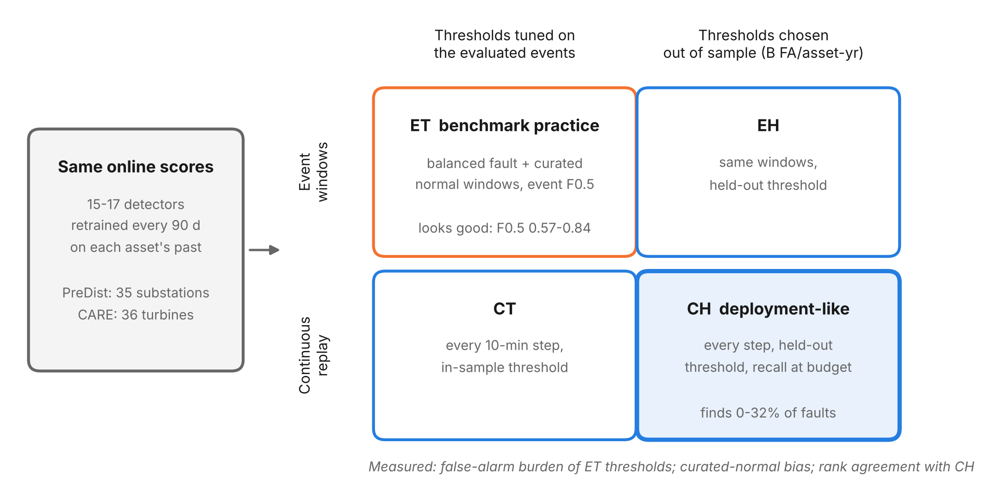
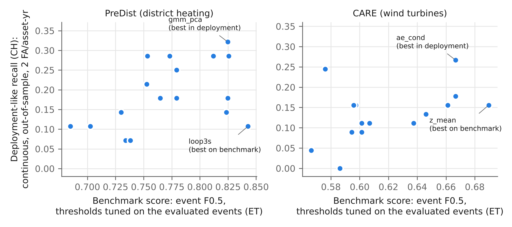
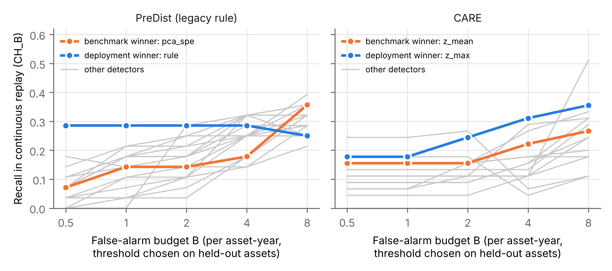
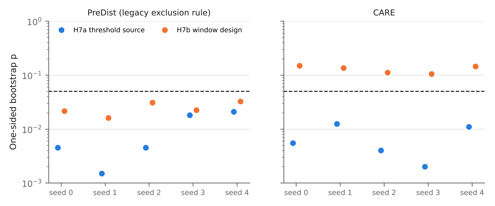

<!-- Version 2 (2026-11-28). Every number is traced to a committed result file in submission/NUMBER_SOURCES.md. -->

# Highlights

- We replay balanced fault-detection benchmarks continuously on 35 substations and 36 wind turbines.
- Thresholds chosen on the benchmark imply 6.7–16.7 false alarms per turbine-year in operation.
- On district heating, the same practice implies 83–176 false-alarm days per substation-year.
- Curated normal periods draw 0.21–0.42 times the alarms of random normal operation.
- The benchmark winner ranks 13th of 17 in deployment at two false alarms per year.

# Abstract

Public benchmarks for early fault detection in energy systems score detectors on short event windows. The windows are balanced between faults and hand-picked normal periods, and the thresholds are tuned on the events being scored. Operators instead run a detector continuously with a fixed threshold. They judge it by how many faults it finds within a tolerable number of false alarms.

We measure the gap between these two views on two public, labelled benchmarks: PreDist (35 district heating substations) and CARE to Compare (36 wind turbines in three farms). A pre-registered panel of 15–17 detectors is evaluated under four protocols built from the same online scores.

- **False-alarm burden.** Thresholds that maximise the benchmark score imply 6.7–16.7 false alarms per turbine-year in continuous operation, and 83–176 false-alarm days per substation-year. Benchmark precision exceeds deployed alarm precision by 7.6–20.6 times.
- **Curated-normal bias.** The curated normal periods are quieter than ordinary operation. They draw alarms at 0.21 (95% CI 0.05–0.37) and 0.42 (0.27–0.61) times the rate of random normal windows.
- **Ranking.** Across false-alarm budgets of 0.5–8 per asset-year, the benchmark winner is outside the deployment top three at 60–100% of budgets in every seed. On district heating it ranks 13th of 17 at two false alarms per year. On wind turbines, the benchmark ranking is essentially unrelated to the multi-budget deployment ranking (Kendall τ between −0.06 and 0.12).

Choosing thresholds out of sample improves agreement in every seed. However, under calibrated randomisation tests this improvement is not statistically established with current benchmark sizes. We release the protocol and a reporting checklist.

**Keywords:** fault detection; anomaly detection; evaluation protocol; false alarms; district heating; wind turbine SCADA

# Nomenclature

| Symbol / acronym | Meaning |
|---|---|
| B | false-alarm budget, alarms per asset-year |
| CH, CH_B | continuous replay with out-of-sample thresholds (deployment-like reference), at budget B |
| CHA | mean of CH_B over B ∈ {0.5, 1, 2, 4, 8} (multi-budget reference) |
| CT | continuous replay, thresholds tuned in sample |
| EH | event windows, out-of-sample thresholds |
| ET | event windows, thresholds tuned on the evaluated events (benchmark practice) |
| AE | autoencoder |
| FA | false alarm |
| NBM | normal-behaviour model |
| SCADA | supervisory control and data acquisition |
| τ | Kendall's rank correlation (tau-b) |

# 1. Introduction

Early fault detection from operational data is one of the most active uses of machine learning in energy systems. District heating substations and wind turbines are typical targets. Many similar assets record 10-minute data, faults are costly, and labelled faults are scarce [21, 24, 32]. In district heating, substation faults also raise return temperatures, which increases supply costs and works against low-temperature networks [22, 23, 33]. Most proposed detectors are unsupervised normal-behaviour models that raise an alarm when operation departs from learned normal behaviour by more than a threshold [19, 24, 28].

A detector is useful only if its alarms can be followed up. Industrial alarm management treats the alarm rate as a design constraint, because alarm floods degrade operator response [25, 26, 35, 36]. The operator's question is therefore concrete: how many faults does the detector find before they are reported, at a false-alarm rate per asset and year that the maintenance team can handle?

Public benchmarks answer a different question. The two labelled public datasets used here, PreDist [1] and CARE to Compare [2], work in the same way:

- detectors are scored on short windows before known faults and on a similar number of hand-picked normal periods;
- the decision threshold is chosen to maximise an event-level F0.5 score on those same events.

The PreDist authors state that the balanced design overestimates precision, because faults are much rarer in practice [1]. Outside energy, it is known that tuned or point-adjusted evaluation can mislead rankings [3, 13], that calibrating thresholds on test data biases results [5], and that low-false-alarm evaluation reorders detectors [4]. On wind SCADA data, leakage-controlled and cross-asset studies report optimistic thresholds and weak discrimination at an alarm budget [6–9]. A recent review in this journal calls for leakage-aware evaluation of energy time-series models [37].

What has not been measured is how far the benchmark view is from deployment on the benchmarks the energy community actually uses. Such a measurement needs four things:

- replaying every detector over every asset's full record;
- enough detectors for rank statistics;
- several false-alarm budgets;
- an analysis plan fixed before the results are seen.

This journal has published evaluation studies of this kind for forecasting [15], materials discovery [16] and concept drift in district heating [17]. The closest fault-detection study evaluates PreDist with window-level scores at an oracle threshold [14].

We do not claim that the base-rate effect [10, 11] or threshold leakage [3–5] is new. Our contributions are measurements, a negative result and a reporting proposal:

1. **False-alarm burden.** On two public energy benchmarks and 15–17 detectors, we quantify the false-alarm burden that benchmark-chosen thresholds imply in continuous operation, and the resulting precision inflation (Section 5.2).
2. **Curated-normal bias.** We identify and measure a selection effect in how the benchmarks were built: curated normal periods are quieter than ordinary operation, which inflates benchmark precision beyond the base-rate effect (Section 5.3).
3. **Operator-budget analysis.** We show that the benchmark winner is not the deployment winner at almost any false-alarm budget. We also show that thresholds calibrated on held-out assets do not reliably deliver their target budget (Section 5.4).
4. **A pre-registered test of what drives ranking disagreement, reported as a negative result.** We decompose the disagreement into threshold source and window design. The direction is consistent, but the effect is not established under calibrated tests, and we explain why the available benchmark sizes cannot establish it (Section 5.5).
5. **A reporting checklist** that makes benchmark results readable in operator units (Section 6.2).

# 2. Related work

**Benchmarks for early fault detection in energy systems.**

- *CARE to Compare* [2] provides SCADA data from 36 turbines in three wind farms. It has 95 labelled events: 45 anomalies and 50 normal periods in the version used. The CARE score combines a pointwise F0.5, accuracy on normal periods, an event-wise F0.5 (reliability) and an earliness term.
- *PreDist* [1] provides 10-minute data from 93 district heating substations of two controller manufacturers, labelled from service records. Its reliability score is an event-wise F0.5, with the threshold chosen by cross-validation over the evaluated events. Both dataset papers present the balanced design as a choice made for comparability, and PreDist notes the resulting overestimate [1].
- *Other evaluations on these and related data.* Van Dreven et al. [14] evaluate a self-supervised transformer on PreDist with window-level ROC-AUC and macro F1. Other district heating studies report case studies, substation-level accuracy, clustering quality or sample-level false-alarm counts [18, 21, 24, 27, 28]. A reproducibility study of HVAC fault detection [20] and a drift-detection benchmark for district heating [17] show, in this journal, that evaluation design shapes reported performance.

**Evaluation pitfalls in anomaly detection.**

- The base-rate fallacy [10] and the weakness of ROC analysis on imbalanced data [11] are textbook issues.
- For time series, Kim et al. [3] showed that point adjustment produces misleading rankings, and Wu and Keogh [13] criticised unrealistic anomaly density in benchmarks.
- Cools et al. [5] showed that calibrating thresholds on the test set biases results, and Salem and Ferrugem [4] that low-false-alarm evaluation changes detector rankings.
- Lavin and Ahmad [30] proposed a streaming benchmark that penalises false positives.

**Wind turbine SCADA.** Recent CARE-based work covers several protocols:

- leakage-controlled calibration [6];
- cross-asset conformal monitoring [8];
- farm-specific models [9];
- an unreviewed, pre-registered study at an alarm budget [7].

None of these replays benchmark-chosen thresholds over the full continuous record. None measures the curated-normal selection effect, and none compares rankings across budgets under one protocol on two domains.

**Alarm-rate guidance.** Process-industry alarm management (EEMUA 191, as reported in [35]) recommends no more than about one alarm per 10 minutes per control-room operator in normal operation. The Norwegian YA-711 guidance, reproduced in [36], gives similar figures. These limits concern operator workload in a control room, not maintenance alarms per monitored asset. To our knowledge, no published operator source gives a tolerable false-alarm rate per turbine-year or per substation-year. We therefore report results as a function of the budget rather than at a single assumed value.

# 3. Data and detectors

## 3.1 Datasets

**PreDist** [1] (CC BY 4.0) contains data from 93 German district heating substations. We use the 35 substations of the first controller manufacturer: 144 substation-years of 10-minute data, 29 early-detectable fault reports and 35 curated normal events. Detection windows are the 7 days before each report, following the dataset [1]. The 58 substations of the second manufacturer were used in an earlier locked transfer test that was evaluated more than once, so they are excluded here (Section 6.3).

**CARE to Compare** [2] contains 36 turbines in three farms and 95 events (45 anomalies, 50 normal periods). We use the dataset's event windows.

## 3.2 Detector panel

The panel was fixed before any of its scores were computed (pre-registration plan_v2, Supplementary S2). It has 12 generic detectors that run on both datasets:

- per-signal maximum and mean z-scores, a robust z-score, an EWMA z-score and a quantile-exceedance fraction;
- PCA residual (SPE) and Hotelling T²;
- Ledoit–Wolf Mahalanobis distance;
- k-nearest-neighbour, LOF, GMM and isolation-forest scores on PCA components [29].

The dataset-specific detectors from earlier work are added to these:

- *PreDist:* an expert control-loop rule, a loop-residual three-sigma statistic, an own-history quantile NBM [28], the PreDist benchmark autoencoder [1] and a conditional autoencoder.
- *CARE:* a temperature three-sigma statistic, an autoencoder and a conditional autoencoder.

For robustness analyses the detectors are grouped into six pre-specified families: z-score, linear, density, physics/expert, NBM and autoencoder.

Every detector is trained online on the asset's own past. It is retrained every 90 days, and its nominal threshold is the 99th percentile of its training scores. Stochastic detectors are run with seeds 0–4. All detectors share one alarm logic and one (τ, c) grid: a persistence counter rises while the score exceeds τ and falls otherwise, and an alarm is active while the counter is at least c.

# 4. Evaluation protocols and statistics

## 4.1 Four protocols on the same scores

Each detector's online score series is evaluated in a 2×2 design (Fig. 1, Table 1).

The **window design** is one of two:

- *event windows:* the benchmark's fault windows and curated normal events; an event is flagged if an alarm is active anywhere in it;
- *continuous replay:* every monitored step of every asset; alarm starts outside fault windows and exclusion intervals count as false alarms per asset-year.

The **threshold source** is also one of two:

- *tuned on the evaluated events:* the (τ, c) that maximises event F0.5, or recall at ≤ B false alarms per asset-year for continuous replay;
- *chosen out of sample:* the point selected on held-out assets at budget B. For CARE the held-out set is leave-one-farm-out; for PreDist it is 5-fold substation cross-validation with fixed folds.

The CH cell is the deployment-like reference. We evaluate it at B = 2 as pre-registered, and additionally at B ∈ {0.5, 1, 2, 4, 8}. The mean over these budgets (CHA) is a multi-budget reference.

**Table 1.** The four protocol cells.

| | Thresholds tuned on evaluated events | Thresholds chosen out of sample |
|---|---|---|
| **Event windows** | ET (benchmark practice): event F0.5 | EH: event F0.5 at held-out B = 2 point |
| **Continuous replay** | CT: recall at in-sample point, ≤ 2 FA/asset-yr | **CH (reference)**: recall at held-out point, budget B |

## 4.2 Pre-registered analyses

All analyses were committed to version control before they were run. Commit times are listed in Supplementary S1.

**Burden and selection effect.** These were pre-registered in earlier rounds, and the selection effect again in plan_v2.

- *CARE burden:* the continuous false-alarm rate at each detector's benchmark-optimal point, and the inflation factor (event precision ÷ deployed alarm precision at the held-out B = 2 point), with cluster-bootstrap 95% CIs [31, 34].
- *PreDist burden:* the false-alarm days per substation-year implied by the oracle threshold of a balanced window-level protocol in the style of [14]. The balanced set has 442 asset-days, including all 221 faulty days, out of 45,632 asset-days.
- *Selection effect (H7d):* the pooled alarm-hit rate on curated normal events divided by the rate on 2,000 random eligible normal windows of matched length, at each detector's held-out B = 2 point.

**Ranking disagreement (plan_v2).** Two contrasts test what drives disagreement with the reference:

- H7a: τ(EH, CH) − τ(ET, CH) > 0 (threshold source);
- H7b: τ(CT, CH) − τ(ET, CH) > 0 (window design).

They were tested with a one-sided percentile cluster bootstrap over assets and Holm's correction over the two datasets. A blind internal review found that this bootstrap is biased towards the alternative, because the tuned cells are re-tuned inside each resample.

We therefore pre-registered two amendments before running them:

- **A1** adds a null-centred bootstrap (T1) and an exact within-detector label-swap randomisation test (T2). A contrast counts as *confirmed* only if both reject after Holm.
- **A2** repeats the contrasts against the multi-budget reference CHA (H9a, H9b) with the label-swap test, Holm, and a robustness rule of at least 4 of 5 seeds. It adds three descriptive analyses: the deployment rank of the benchmark winner at each budget, the realised false-alarm rate of held-out thresholds, and leave-one-family-out stability.

## 4.3 Leakage control and reproducibility

A legacy exclusion rule in the PreDist pipeline let 4 of 588 model refits (substations 4 and 7) see the timing of future fault reports. All PreDist results reported as primary use the corrected, leak-free rule. The legacy results are given as a sensitivity analysis. CARE used the leak-free rule from the start.

The leak-free PreDist seed-0 analysis was regenerated from raw data on a second machine and reproduced the reported tables exactly. The legacy seed-0 analysis was reproduced byte-for-byte on a third.

# 5. Results

## 5.1 Benchmark scores versus deployment-like recall

Under benchmark practice (ET), every detector looks useful. Event F0.5 ranges from 0.69 to 0.84 on PreDist and from 0.57 to 0.69 on CARE (Table 2). Under the deployment-like reference at B = 2, the same detectors find 7–32% of PreDist faults and 0–27% of CARE anomalies.

The detector with the best benchmark score is not the best deployed detector (Fig. 3):

- On PreDist, the benchmark favours the loop-residual three-sigma statistic (ET 0.84). It finds 11% of faults at B = 2, while the GMM detector finds 32%.
- On CARE, the benchmark favours the mean z-score (ET 0.69, CH 0.16), while the conditional autoencoder reaches CH 0.27.

**Table 2.** Benchmark score (ET, event F0.5) and deployment-like recall (CH, B = 2) per detector, seed 0; PreDist leak-free.

| Detector | PreDist ET | PreDist CH | CARE ET | CARE CH |
|---|---|---|---|---|
| z_max | 0.75 | 0.21 | 0.58 | 0.24 |
| z_mean | 0.78 | 0.18 | 0.69 | 0.16 |
| robust_z_max | 0.69 | 0.11 | 0.57 | 0.04 |
| q_frac | 0.73 | 0.07 | 0.64 | 0.11 |
| pca_spe | 0.82 | 0.14 | 0.60 | 0.16 |
| pca_t2 | 0.78 | 0.25 | 0.60 | 0.11 |
| maha_lw | 0.83 | 0.18 | 0.65 | 0.13 |
| knn_pca | 0.81 | 0.29 | 0.60 | 0.09 |
| lof_pca | 0.83 | 0.29 | 0.60 | 0.09 |
| gmm_pca | 0.83 | 0.32 | 0.61 | 0.11 |
| iforest_pca | 0.77 | 0.29 | 0.59 | 0.00 |
| ewma_z_max | 0.77 | 0.18 | 0.60 | 0.16 |
| expert rule / temp. 3σ | 0.75 | 0.29 | 0.66 | 0.16 |
| loop-residual 3σ | 0.84 | 0.11 | – | – |
| quantile NBM | 0.70 | 0.11 | – | – |
| autoencoder | 0.73 | 0.14 | 0.67 | 0.18 |
| conditional AE | 0.74 | 0.07 | 0.67 | 0.27 |

## 5.2 False-alarm burden at benchmark-chosen thresholds

**CARE.** At the thresholds that maximise the benchmark score, continuous operation produces these false-alarm rates:

| Detector | False alarms per turbine-year |
|---|---|
| temperature three-sigma | 6.7 |
| isolation forest | 10.6 |
| three-sigma | 10.8 |
| conditional autoencoder | 15.8 |
| autoencoder | 16.7 |

Event precision at the benchmark point is 0.55–0.84. Deployed alarm precision at the held-out B = 2 point is 0.036–0.071. For the four detectors that raise alarms, the inflation factor therefore ranges from 7.6 (95% CI 5.0–16.7) to 20.6 (13.5–37.4). The isolation forest raises no alarm at its held-out point, so its ratio is undefined.

**PreDist.** At the oracle threshold of the balanced window protocol, all 17 detectors imply at least 10 false-alarm days per substation-year. The range is 83–176, with a median of about 135. At natural prevalence (0.5% faulty days), the best achievable macro F1 is 0.50–0.53 for every detector, essentially the score of never raising an alarm.

## 5.3 Selection effect in curated normal periods

Curated normal events draw far fewer alarms than ordinary normal operation (Fig. 4). The pooled ratio of alarm-hit rates (curated ÷ random normal windows) is:

- 0.21 (95% CI 0.05–0.37) on PreDist (legacy rule: 0.30, 0.11–0.52);
- 0.42 (0.27–0.61) on CARE.

The ratio is below 1 for 16 of 17 PreDist detectors and 13 of 14 evaluable CARE detectors, and H7d holds in every seed analysed: 5 of 5 on CARE, 5 of 5 on PreDist with the legacy rule, and 3 of 3 completed leak-free PreDist seeds (pooled ratios 0.18–0.23) [LEAKFREE_SEEDS_PENDING]. The effect is detector-dependent:

- on PreDist, ten detectors raise no alarm at all on the 35 curated normal events, while the conditional autoencoder (2.45) is an exception;
- on CARE, the robust z-score (3.20) is an exception.

Because curated normal periods are easier than typical operation, benchmark precision is inflated beyond what the base rate alone explains.

## 5.4 The operator's view across budgets

Fig. 5 shows deployment-like recall as a function of the false-alarm budget. The thresholds are always chosen on held-out assets.

**The benchmark winner is not the deployment winner.**

- On PreDist (leak-free), the benchmark winner ranks 15th, 12th, 13th, 3rd and 2nd of 17 at B = 0.5, 1, 2, 4 and 8. At B ≤ 1 it finds no faults, or 11% of them. The expert control-loop rule finds 29% at every budget up to 4.
- On CARE, the benchmark winner ranks 4th at B ≤ 4 and 7th at B = 8.
- Across all ten seed–dataset runs, the benchmark winner is outside the deployment top three at 60–100% of the budgets.

**Against the multi-budget reference, the benchmark ranking carries little information.** τ(ET, CHA) is −0.06 to 0.12 across the five CARE seeds and 0.43 on PreDist (leak-free, seed 0; legacy seeds 0.30–0.49).

**Held-out calibration does not reliably deliver the target budget.** On CARE, held-out thresholds overshoot low budgets. The median realised rate over detectors is 1.84 false alarms per turbine-year at a target of 0.5 and at a target of 1, and 2.20 at a target of 2. On PreDist they stay within budget (0.33, 0.82 and 1.66 at the same three targets). An operator who sets a threshold on other farms should therefore expect more alarms than planned.

## 5.5 What drives ranking disagreement? A negative result

Against the pre-registered B = 2 reference, τ(ET, CH) is 0.34 on PreDist (legacy 0.18) and 0.43 on CARE. Out-of-sample thresholds raise it to 0.65 and 0.74 (EH), and the increase appears in all five seeds of both datasets. Continuous replay with in-sample thresholds raises it on PreDist (0.83) but lowers it on CARE (0.30).

The pre-registered percentile bootstrap rejects three of the four Holm-corrected tests (Table 3). The calibrated tests of Amendment A1 confirm none:

- for the threshold-source effect (H7a), T1/T2 p-values are 0.060/0.18 on PreDist and 0.065/0.18 on CARE;
- for the window-design effect (H7b), T1 rejects on PreDist (p = 0.007), but T2 does not (0.092).

Against the multi-budget reference (Amendment A2), the label-swap tests are also not significant:

- seed-0 p-values for H9a and H9b are 0.41 and 0.16 on PreDist, and 0.16 and 0.11 on CARE;
- across CARE seeds, H9a reaches p < 0.05 in 2 of 5 seeds and H9b in 0 of 5;
- the direction is stable: H9b is positive whichever detector family is removed, on both datasets, and H9a in 25 of 25 CARE and 5 of 6 leak-free PreDist family drops.

We therefore report the threshold-source and window-design effects on rankings as **consistent in direction but not statistically established**. The design limits power in two ways. With 15–17 detectors, τ has few distinct values. The reference counts only 2–9 detected faults per detector on PreDist and 0–12 on CARE, so many detectors are tied. Establishing such contrasts will need benchmarks with more faults and more independent detectors than PreDist and CARE currently provide.

**Table 3.** Ranking-disagreement tests, seed 0, one-sided p-values. Pre-reg. = percentile cluster bootstrap with the Holm decision of record. T1 = null-centred bootstrap; T2 = within-detector label swap (A1). A2 = label swap against the multi-budget reference. PreDist results are leak-free.

| Contrast | Pre-reg. (Holm) | T1 | T2 | A2 |
|---|---|---|---|---|
| Threshold source, PreDist | 0.017 (rejected) | 0.060 | 0.18 | 0.41 |
| Window design, PreDist | 0.012 (rejected) | 0.007 | 0.092 | 0.16 |
| Threshold source, CARE | 0.0055 (rejected) | 0.065 | 0.18 | 0.16 |
| Window design, CARE | 0.15 (not rejected) | 0.68 | 0.61 | 0.11 |

## 5.6 How much can a benchmark certify?

With n normal windows, a benchmark says little about a deployed false-alarm rate. The 65 normal 7-day windows of PreDist give power 0.23 to distinguish 1 from 2 false alarms per asset-year. The 50 normal periods of CARE give power 0.12 for 7-day windows, or 0.35 at their mean length of 14.9 days [12]. Even a perfect event score therefore cannot certify an operator's alarm budget.

# 6. Discussion

## 6.1 Implications for practice

At the median PreDist oracle threshold, a utility with 100 substations would face about 13,500 false-alarm days per year. For a 36-turbine fleet, the benchmark-chosen CARE thresholds would produce 240–600 false alarms per year. The benchmark score warns of neither.

The budget sweep adds two practical points:

- the detector to deploy depends on the budget, and at tight budgets simple physically anchored rules can beat every learned detector;
- thresholds transferred from other farms can exceed their target budget, so the first months of deployment should include monitoring of the alarm rate itself.

Three rules follow:

1. Choose thresholds on assets or periods that are not evaluated.
2. Compare detectors at the budget the maintenance team can actually absorb, measured by continuous replay.
3. Check the alarm rate on random normal time, not only on curated normal periods.

## 6.2 A reporting checklist for early fault detection benchmarks

In addition to any benchmark score, we propose reporting:

- (i) the threshold source and the data it was chosen on;
- (ii) recall at several false-alarm budgets per asset-year in continuous replay, with confidence intervals clustered by asset;
- (iii) the realised false-alarm rate of transferred thresholds;
- (iv) the asset-years of normal exposure behind every false-alarm estimate;
- (v) the alarm rate on random normal windows next to curated normal events;
- (vi) for any ranking claim, the number of detectors and events and a calibrated test.

Items (ii)–(v) need only the continuous data that PreDist and CARE already publish.

## 6.3 Limitations

- **Labels.** The absence of a fault report does not guarantee fault-free operation, so measured false-alarm rates are upper bounds.
- **Event counts.** Fault events are few (29 and 45), and intervals are wide.
- **Ranking analysis.** It is underpowered, and its contrasts are not established under calibrated tests. Panel members within a family are related, and only four detectors are stochastic, so seeds are not independent replications.
- **Panel coverage.** The panel does not include a large pretrained time-series foundation model [37].
- **Prior use of the data.** Both datasets were used in earlier development rounds of this project, so the analyses are pre-registered but exploratory, not blind.
- **Second manufacturer.** The second PreDist manufacturer is excluded because an earlier locked test on it was evaluated more than once.
- **Leak correction.** Correcting the legacy PreDist exclusion rule changed some individual detector results; one detector's recall changed by 4 of 28 faults. Every conclusion kept its direction, and leak-free numbers are primary.
- **Budget.** No operator source gives a tolerable false-alarm budget per asset, so results are reported across budgets.

# 7. Conclusions

On two public energy benchmarks and 15–17 detectors, the balanced event-window view and the continuous, threshold-fixed view describe different detectors.

- Benchmark-chosen thresholds imply 6.7–16.7 false alarms per turbine-year and 83–176 false-alarm days per substation-year.
- Curated normal periods draw a fifth to two-fifths of the alarms of ordinary operation.
- The benchmark winner is outside the deployment top three at most budgets.
- Out-of-sample thresholds bring rankings closer in every seed, but current benchmark sizes cannot establish this effect under calibrated tests.

Reporting recall across false-alarm budgets in continuous replay, with out-of-sample thresholds and random normal windows as controls, would make fault-detection benchmarks informative for the operators they are meant to serve.

# Figures

# Declarations

**Data availability.** PreDist (doi:10.5281/zenodo.19496480) and CARE to Compare (Zenodo record 14958989) are public. All code, pre-registrations with commit history, logs and result tables will be archived with a DOI on Zenodo upon acceptance [to be created by the authors].

**CRediT author statement.** [To be completed by the authors.]

**Declaration of competing interest.** [To be completed by the authors.]

**Declaration of generative AI and AI-assisted technologies in the writing process.** During the preparation of this work the authors used Anthropic Claude for code assistance, analysis and drafting. The authors reviewed and edited the content and take full responsibility for it. [Authors to confirm.]

**Funding.** [To be completed by the authors.]

# References

[1] Roelofs C.M., Bastidas E.G., Hugo T., Faulstich S., Cadenbach A., Enabling predictive maintenance in district heating substations: A labelled dataset and fault detection evaluation framework based on service data, Energy, 355 (2026) 141178. https://doi.org/10.1016/j.energy.2026.141178

[2] Gück C., Roelofs C.M.A., Faulstich S., CARE to Compare: A Real-World Benchmark Dataset for Early Fault Detection in Wind Turbine Data, Data, 9 (2024) 138. https://doi.org/10.3390/data9120138

[3] Kim S., Choi K., Choi H., Lee B., Yoon S., Towards a Rigorous Evaluation of Time-Series Anomaly Detection, Proceedings of the AAAI Conference on Artificial Intelligence, 36 (2022) 7194-7201. https://doi.org/10.1609/aaai.v36i7.20680

[4] Salem M., Ferrugem A., Low-False-Alarm Evaluation Changes the Ranking of Multisensor Anomaly Detectors, Spectrum, 27 (2026). https://doi.org/10.55972/spectrum.v27i1.439

[5] Cools A., Stassin S., Mahmoudi S., The Threshold Paradox: Why Calibrating on the Test Set Introduces Bias in Anomaly Detection, Proceedings of the 21st International Conference on Computer Vision Theory and Applications (2026) 475-482. https://doi.org/10.5220/0014392600004084

[6] Liu J., Chen J., Wang C., Chronologically calibrated PCA for wind-turbine SCADA health monitoring: a leakage-controlled CARE v6 benchmark, Copernicus GmbH (2026). https://doi.org/10.5194/wes-2026-145

[7] Song S.B., Reproducibility package for "Detection without discrimination: a blinded, pre-registered test of pre-fault signals in public wind-turbine SCADA data", Zenodo (2026), unreviewed (verified via DataCite). https://doi.org/10.5281/zenodo.23902231

[8] Haneef Z., Umar M., Saleem F., Ullah I., Aqeel K., Siddique M.F., Uncertainty-Calibrated Residual Conformal Monitoring of Wind Turbine SCADA Data for Cross-Asset Anomaly Detection Under Distribution Shift, Information, 17 (2026) 930. https://doi.org/10.3390/info17090930

[9] Vural B., Farm-Specific Anomaly Detection in Wind Turbine SCADA Data, 2026 11th International Conference on Computer Science and Engineering (UBMK) (2026) 1017-1022. https://doi.org/10.1109/ubmk71847.2026.11745258

[10] Axelsson S., The base-rate fallacy and the difficulty of intrusion detection, ACM Transactions on Information and System Security, 3 (2000) 186-205. https://doi.org/10.1145/357830.357849

[11] Saito T., Rehmsmeier M., The Precision-Recall Plot Is More Informative than the ROC Plot When Evaluating Binary Classifiers on Imbalanced Datasets, PLOS ONE, 10 (2015) e0118432. https://doi.org/10.1371/journal.pone.0118432

[12] Leber D.D., Pibida L., False Alarm Testing for Radiation Detection Systems, National Institute of Standards and Technology (2020). https://doi.org/10.6028/nist.tn.2118

[13] Wu R., Keogh E., Current Time Series Anomaly Detection Benchmarks are Flawed and are Creating the Illusion of Progress, IEEE Transactions on Knowledge and Data Engineering (2021) 1-1. https://doi.org/10.1109/tkde.2021.3112126

[14] van Dreven J., Cheddad A., Ghazi A.N., Alawadi S., Koussa J.A., Vanhoudt D. et al., From lab to practice: Towards a substation-invariant self-supervised transformer for low-label fault detection in district heating, Energy and AI, 25 (2026) 100824. https://doi.org/10.1016/j.egyai.2026.100824

[15] Agrawal A., O'Sullivan A., Tail reliability of machine-learning probabilistic forecasts in the GB day-ahead electricity market, Energy and AI, 26 (2026) 100975. https://doi.org/10.1016/j.egyai.2026.100975

[16] Kim M., Lee J., Chun H.W., Shin E.S., Choi H., Kang D. et al., Cross-laboratory generalization failure in perovskite solar cell machine learning: A diagnostic protocol and evaluation threshold, Energy and AI, 25 (2026) 100856. https://doi.org/10.1016/j.egyai.2026.100856

[17] Derzsi K., Klingebiel J., Müller D., Concept drift detection in district heating: A characterization framework and detector-centric benchmark, Energy and AI, 25 (2026) 100788. https://doi.org/10.1016/j.egyai.2026.100788

[18] van Dreven J., Cheddad A., Ghazi A.N., Alawadi S., Al Koussa J., Vanhoudt D., HEAT: Hierarchical-constrained Encoder-Assisted Time series clustering for fault detection in district heating substations, Energy and AI, 21 (2025) 100548. https://doi.org/10.1016/j.egyai.2025.100548

[19] Roelofs C.M., Gück C., Faulstich S., Transfer learning applications for autoencoder-based anomaly detection in wind turbines, Energy and AI, 17 (2024) 100373. https://doi.org/10.1016/j.egyai.2024.100373

[20] Mukhtar A., Hadwiger M., Wotawa F., Schweiger G., Reproducibility of machine learning-based fault detection and diagnosis for HVAC systems in buildings: An empirical study, Energy and AI, 22 (2025) 100658. https://doi.org/10.1016/j.egyai.2025.100658

[21] Gadd H., Werner S., Fault detection in district heating substations, Applied Energy, 157 (2015) 51-59. https://doi.org/10.1016/j.apenergy.2015.07.061

[22] Lund H., Werner S., Wiltshire R., Svendsen S., Thorsen J.E., Hvelplund F. et al., 4th Generation District Heating (4GDH), Energy, 68 (2014) 1-11. https://doi.org/10.1016/j.energy.2014.02.089

[23] Werner S., International review of district heating and cooling, Energy, 137 (2017) 617-631. https://doi.org/10.1016/j.energy.2017.04.045

[24] Neumayer M., Stecher D., Grimm S., Maier A., Bücker D., Schmidt J., Fault and anomaly detection in district heating substations: A survey on methodology and data sets, Energy, 276 (2023) 127569. https://doi.org/10.1016/j.energy.2023.127569

[25] Wang J., Yang F., Chen T., Shah S.L., An Overview of Industrial Alarm Systems: Main Causes for Alarm Overloading, Research Status, and Open Problems, IEEE Transactions on Automation Science and Engineering, 13 (2016) 1045-1061. https://doi.org/10.1109/tase.2015.2464234

[26] Beebe D., Ferrer S., Logerot D., The Connection of peak alarm rates to plant incidents and what you can do to minimize, Process Safety Progress, 32 (2012) 72-77. https://doi.org/10.1002/prs.11539

[27] Månsson S., Johansson Kallioniemi P., Thern M., Van Oevelen T., Sernhed K., Faults in district heating customer installations and ways to approach them: Experiences from Swedish utilities, Energy, 180 (2019) 163-174. https://doi.org/10.1016/j.energy.2019.04.220

[28] Hermans C., Al Koussa J., Van Oevelen T., Vanhoudt D., Fault detection for district heating substations: Beyond three-sigma approaches, Smart Energy, 16 (2024) 100159. https://doi.org/10.1016/j.segy.2024.100159

[29] Liu F.T., Ting K.M., Zhou Z., Isolation Forest, 2008 Eighth IEEE International Conference on Data Mining (2008) 413-422. https://doi.org/10.1109/icdm.2008.17

[30] Lavin A., Ahmad S., Evaluating Real-Time Anomaly Detection Algorithms -- The Numenta Anomaly Benchmark, 2015 IEEE 14th International Conference on Machine Learning and Applications (ICMLA) (2015) 38-44. https://doi.org/10.1109/icmla.2015.141

[31] Field C.A., Welsh A.H., Bootstrapping Clustered Data, Journal of the Royal Statistical Society Series B: Statistical Methodology, 69 (2007) 369-390. https://doi.org/10.1111/j.1467-9868.2007.00593.x

[32] Tautz‐Weinert J., Watson S.J., Using SCADA data for wind turbine condition monitoring – a review, IET Renewable Power Generation, 11 (2016) 382-394. https://doi.org/10.1049/iet-rpg.2016.0248

[33] Gadd H., Werner S., Achieving low return temperatures from district heating substations, Applied Energy, 136 (2014) 59-67. https://doi.org/10.1016/j.apenergy.2014.09.022

[34] Efron B., Bootstrap Methods: Another Look at the Jackknife, The Annals of Statistics, 7 (1979) 1-26. https://doi.org/10.1214/aos/1176344552

[35] Reising D.V.C., Downs J.L., Bayn D., Human Performance Models for Response to Alarm Notifications in the Process Industries: An Industrial Case Study, Proceedings of the Human Factors and Ergonomics Society Annual Meeting, 48 (2004) 1189-1193. https://doi.org/10.1177/154193120404801009

[36] Goetz C., Pragmatic Analytics of Control System Alarms for Improved Drilling Performance and Equipment Maintenance, SPE/IADC Drilling Conference and Exhibition (2017) D031S018R004. https://doi.org/10.2118/184659-MS

[37] Tahavori M., Shaker H.R., Time-series foundation models for energy infrastructure: Evidence and requirements for digital-twin-grade integration, Energy and AI, 26 (2026) 100959. https://doi.org/10.1016/j.egyai.2026.100959
